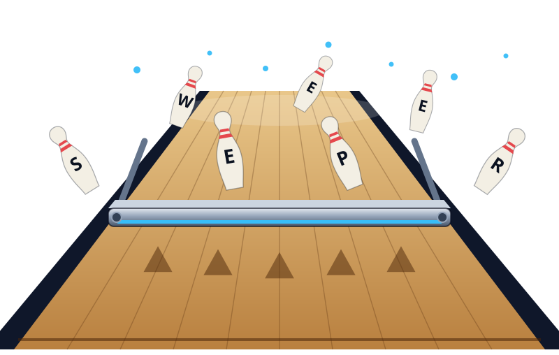

<p align="center"></p>

# Sweeper — bowling league platform

A mobile-first website for running bowling leagues: configurable handicap and scoring rules, weekly matchup
pages, live standings and playoffs, bowler profiles, records, awards, commissioner tools, versioned rules and
full audit history. Multiple independent leagues, each with its own members and roles.

> **Storage:** the app runs on **PostgreSQL (including Supabase)** when `DATABASE_URL` is set, or on embedded Postgres
> (`BOWL_PGLITE_DIR`), or — with nothing configured — a single-instance JSON file store. The whole test suite passes on all
> three, and the browser tests pass against a real Postgres 16 server. Supabase Auth is **not** used (the app has its own
> accounts). See [docs/SUPABASE.md](docs/SUPABASE.md) and [docs/HANDOFF.md](docs/HANDOFF.md) for limits and what remains.

## Quick start

```bash
npm install
cp .env.example .env.local        # set SESSION_SECRET for anything but local play
npm run dev                       # http://localhost:3000
```

1. **Register** at `/register` — the first account becomes the owner of whatever league it creates.
2. **Create a league** (`/leagues/new`) — a six-step wizard: basics, format, games & scoring, handicap
   (with a live example), standings & playoffs, review.
3. Or click **Try a demo league** on the home page for simulated data (clearly labelled *DEMO DATA*; remove it from
   Commissioner → Seasons). CLI: `npm run seed:demo -- you@example.com`.

## Commands

| Command | What it does |
| --- | --- |
| `npm run dev` / `build` / `start` | Next.js dev server / production build / serve the build |
| `npm test` | Unit + integration + security tests (Vitest, 134 tests incl. SQL/RLS; browser tests live in `e2e/`) |
| `npm run lint` | Type-check (`tsc --noEmit`) |
| `npm run seed:demo -- <email>` | Create a removable demo league (refuses in production) |
| `npm run db:migrate` | Apply SQL migrations to `DATABASE_URL` / `BOWL_PGLITE_DIR` |
| `npm run db:import-file -- db.json` | One-time copy of a file-store database into Postgres (ids become UUIDs) |
| `npm run test:pg` / `test:pg:server` | The full suite on embedded Postgres / a real server (`TEST_DATABASE_URL`) |
| `npm run db:backup` | Verified copy of the file database into `data/backups/` (file store only) |
| `npm run recover-owner -- <slug> <email>` | Operator recovery: make an account the owner of a league |
| `node e2e/smoke.mjs`, `node e2e/wizard.mjs` | Browser tests (Playwright; install separately) against a running server — see docs/HANDOFF.md |

## How it's organised

```
src/domain/    Pure calculation engine — no I/O. Rules config, handicap, scoring, standings, schedule,
               stats, awards, records, rivalries, insights, rule-change preview, validation.
src/server/    Store (Postgres via src/server/pg, or transactional file DB), auth, permission matrix, services (every mutation is
               permission-checked and audited), demo data, mailer.
src/app/       Next.js App Router pages, server actions, route handlers (exports, scorecard PNG, PWA).
src/components UI: scoreboard, standings table, score-entry workspace, rule editor, charts, wizard…
supabase/      Postgres schema, RLS policies, local prelude — applied by `npm run db:migrate`.
tests/         Vitest suites. e2e/ has the Playwright smoke test.
docs/          Deployment, backups, Supabase, launch checklist, handoff.
```

The single most important rule of the codebase: **every calculation takes a `RuleConfig`**. No page, service
or component hardcodes a base average, a percentage, a game count or a point value.

## Documentation

- [docs/HANDOFF.md](docs/HANDOFF.md) — architecture, data model, what is done / not done, troubleshooting
- [docs/DESIGN.md](docs/DESIGN.md) — themes, color tokens, type, components, generated images, accessibility check
- [docs/DEPLOYMENT.md](docs/DEPLOYMENT.md) — environment variables, hosting, domains, HTTPS, releases
- [docs/BACKUPS.md](docs/BACKUPS.md) — backups, restore, testing a backup
- [docs/SUPABASE.md](docs/SUPABASE.md) — the Postgres schema, RLS, and the work to connect it
- [docs/LAUNCH_CHECKLIST.md](docs/LAUNCH_CHECKLIST.md) — step-by-step go-live checklist
